# Classroom system: evidence and next steps

Snapshot: **2026-10-25T00:02:58Z**. These are dated observations, not a live health check or an execution grant.

## My actions

None newly required by this map\. The existing recovery owner must first establish the current eligible posting scope and whether the school login actually needs attention\. I\-Tracker access/recipient approval comes only after a validated delivery preview; pilot review comes only after a concrete lesson is ready\. No weekend execution obligation is assigned\.

## Dependency map

Red arrows identify held dependencies; the exact blocker is written on the arrow and below. Clickable evidence and recovery references follow the diagram.

```mermaid
flowchart TB
  classroom["Classroom system"]
  ic["IC interactions — Unverified"]
  ic_post["Eligible posting and native readback — Blocked"]
  ic_csv["Morning posting CSV and Posting log — Still needed"]
  ic_assign["Assignment creation and date alignment — Blocked"]
  ic_parent["Parent dashboard and I-Tracker delivery — Blocked"]
  hub["Teaching Hub — In progress"]
  hub_notes["Class notes: deployed and readable — Verified done"]
  hub_feedback["Saved-feedback review repair — In progress"]
  hub_bindings["Source, roster and Turn-in bindings — Unverified"]
  hub_prep["Lesson Prep notes and next-week reminders — Blocked"]
  slides["Lesson Slides — Still needed"]
  slides_audit["Cycle08 model and NGSS baseline — Unverified"]
  slides_pilot["Revised pilot and classroom evidence — Blocked"]
  slides_lab["Independent enzyme lab release — Blocked"]
  slides_links["Lesson to Agenda to Schoology links — Unverified"]
  my_actions["My actions: None newly required; later actions remain conditional"]
  classroom --> my_actions
  style my_actions fill:#f3e8ff,stroke:#7e22ce,color:#43146d;
  classroom --> ic
  classroom --> hub
  classroom --> slides
  ic --- ic_post
  ic --- ic_csv
  ic --- ic_assign
  ic --- ic_parent
  hub --- hub_notes
  hub --- hub_feedback
  hub --- hub_bindings
  hub --- hub_prep
  slides --- slides_audit
  slides --- slides_pilot
  slides --- slides_lab
  slides --- slides_links
  hub_bindings -->|"Source, roster and exact destination proof missing"| ic_post
  hub_bindings -->|"Agenda and Form/date/section bindings required"| ic_assign
  ic_post -->|"Native saved-grade readback required"| ic_parent
  hub_feedback -->|"Reconciled feedback and reviewed preview required"| ic_parent
  hub_feedback -->|"Active app.js claim must be handed back"| hub_prep
  slides_audit -->|"Verified baseline must precede revised pilot"| slides_pilot
  hub_bindings -->|"Exact Form and roster/assignment mapping required"| slides_lab
  slides_pilot -->|"Reviewed lesson and exact source links required"| slides_links
  hub_bindings -->|"Agenda date, Form and section proof required"| slides_links
  classDef verified_done fill:#e8f5e9,stroke:#2e7d32,color:#163d20;
  classDef in_progress fill:#e3f2fd,stroke:#1565c0,color:#123b62;
  classDef blocked fill:#ffebee,stroke:#b42318,color:#7a1910;
  classDef still_needed fill:#fff8e1,stroke:#8d6e00,color:#514000;
  classDef unverified fill:#f1f3f5,stroke:#6b7280,color:#30343b;
  classDef no_longer_needed fill:#f1f3f5,stroke:#9ca3af,color:#535963;
  class ic unverified;
  class ic_post blocked;
  class ic_csv still_needed;
  class ic_assign blocked;
  class ic_parent blocked;
  class hub in_progress;
  class hub_notes verified_done;
  class hub_feedback in_progress;
  class hub_bindings unverified;
  class hub_prep blocked;
  class slides still_needed;
  class slides_audit unverified;
  class slides_pilot blocked;
  class slides_lab blocked;
  class slides_links unverified;
  linkStyle 16,17,18,19,20,21,22,23,24 stroke:#b42318,stroke-width:3px;
```



## Owners, evidence and remaining work

### IC interactions

| Item / state | Existing owner | Evidence observed | Recovery / remaining action | Katherine action |
| --- | --- | --- | --- | --- |
| IC interactions<br>**Unverified** | Existing I\-12 recovery coordinator; Chrome helper is the sole grade writer | 2026-10-24T20:09:16Z<br>[Existing recovery checkpoint](https://answerableteaching.slack.com/archives/C0C9E488BAN/p1792872556341569) | Existing private I\-12 operations record and immutable run history; resolve through the recovery coordinator. Next: Verify the current source, roster, exact destination and native saved readback. Hold: Current saved\-grade acceptance is not established by the referenced deployment or browser visibility | None newly requested; preserve current recovery coordination\. |
| Eligible posting and native readback<br>**Blocked** | Existing Chrome helper under the current recovery owner | 2026-10-24T20:09:16Z<br>[Existing execution handoff](https://answerableteaching.slack.com/archives/C0C9E488BAN/p1792860170045849); [Recovery checkpoint](https://answerableteaching.slack.com/archives/C0C9E488BAN/p1792872556341569) | Existing private I\-12 operations record and immutable run history; resolve through the recovery coordinator. Next: Reconcile current ownership and exact eligible queue; preserve higher scores and uncertain\-save fences. Hold: Required source/roster/private mapping and exact authenticated score\-panel acceptance remain unverified | None newly requested; preserve current recovery coordination\. |
| Morning posting CSV and Posting log<br>**Still needed** | Existing recovery coordinator; implementation task321 | 2026-10-24T11:39:55Z<br>[CSV task321](https://github.com/kvond/school-workflow-hub/issues/321) | Existing private assessment records and Posting log; CSV is a derivative. Next: Inspect and reuse verified source and posting records; implement privately after claim reconciliation. Hold: A feature request is not a generated export or a posted score | None newly requested; preserve current recovery coordination\. |
| Assignment creation and date alignment<br>**Blocked** | Existing IC owner after Agenda binding acceptance | 2026-10-24T15:19:10Z<br>[Dependency order](https://answerableteaching.slack.com/archives/C0C9E488BAN/p1792855150386299) | Existing private I\-12 operations record and immutable run history; resolve through the recovery coordinator. Next: Verify Agenda date, Form, week, section and component before any assignment action. Hold: Exact deployed Agenda/Turn\-in bindings and private readback must precede assignment changes | None newly requested; preserve current recovery coordination\. |
| Parent dashboard and I\-Tracker delivery<br>**Blocked** | Existing authorized school communication owner | 2026-10-24T15:19:10Z<br>[Parent\-delivery gates](https://answerableteaching.slack.com/archives/C0C9E488BAN/p1792855150386299) | Existing private recipient, preview and delivery records. Next: Prepare only from reconciled data; verify recipients and preview before separately authorized delivery. Hold: Verified grade/feedback data and delivery scope/preview are not established | Only later, when a validated preview is ready: review recipients/scope and open I\-Tracker if requested\. None now\. |

### Teaching Hub

| Item / state | Existing owner | Evidence observed | Recovery / remaining action | Katherine action |
| --- | --- | --- | --- | --- |
| Teaching Hub<br>**In progress** | Existing Codex recovery coordinator; source and feedback owners preserved | 2026-10-24T20:09:16Z<br>[Deployed checkpoint](https://answerableteaching.slack.com/archives/C0C9E488BAN/p1792872556341569); [Open recovery264](https://github.com/kvond/school-workflow-hub/issues/264) | Existing private I\-12 operations record and immutable run history; resolve through the recovery coordinator. Next: Keep deployed read UI separate from source, grading, feedback and delivery receipts. Hold: Deployment/read rendering is verified; live recovery acceptance remains open | None newly requested; preserve current recovery coordination\. |
| Class notes: deployed and readable<br>**Verified done** | Existing Teaching Hub code/integration owner | 2026-10-24T20:08:34Z<br>[Deployment and native read evidence](https://github.com/kvond/school-workflow-hub/issues/314#issuecomment-6388959844) | Versioned Hub source and original private class\-note CAS/history. Next: Obtain real changed\-text Save/reload proof during ordinary teacher use without inserting test policies. Hold: Changed\-text Agenda/class\-note saves remain unexercised in this checkpoint | None newly requested; preserve current recovery coordination\. |
| Saved\-feedback review repair<br>**In progress** | Existing feedback\-recovery PR324 owner; implementation is not live grading | 2026-10-24T23:29:51Z<br>[Reviewed feedback repair324](https://github.com/kvond/school-workflow-hub/pull/324); [Exact\-head CI](https://github.com/kvond/school-workflow-hub/actions/runs/40142898513) | Existing private I\-12 operations record and immutable run history; resolve through the recovery coordinator. Next: Integrate through the existing owner and verify source\-bound native reports and printables. Hold: PR324 remains draft/unmerged at the observed review; no live report acceptance follows from CI | None newly requested; preserve current recovery coordination\. |
| Source, roster and Turn\-in bindings<br>**Unverified** | Existing I\-12 source/roster recovery owner | 2026-10-24T20:09:16Z<br>[Current evidence boundary](https://answerableteaching.slack.com/archives/C0C9E488BAN/p1792872556341569) | Existing private I\-12 operations record and immutable run history; resolve through the recovery coordinator. Next: Read current exact Form, lesson source, roster and section/component evidence. Hold: Current private mapping and source/roster reconciliation were not established by the checkpoint | None newly requested; preserve current recovery coordination\. |
| Lesson Prep notes and next\-week reminders<br>**Blocked** | Task323; serialize with current PR324 UI claim | 2026-10-24T23:57:00Z<br>[Prep task323](https://github.com/kvond/school-workflow-hub/issues/323); [Active app\.js claim324](https://github.com/kvond/school-workflow-hub/pull/324) | Canonical Master Agenda and existing lesson/material links; no second prep tracker. Next: After app\.js handback, implement Agenda\-backed BUY/PULL/PRINT and conditional Biology pathways. Hold: Task323 UI overlaps the active feedback\-repair app\.js claim; no prep implementation/deployment is established | None newly requested; preserve current recovery coordination\. |

### Lesson Slides

| Item / state | Existing owner | Evidence observed | Recovery / remaining action | Katherine action |
| --- | --- | --- | --- | --- |
| Lesson Slides<br>**Still needed** | Existing lesson owner; Dot oversight and bounded Codex implementation | 2026-10-24T19:39:01Z<br>[Current Cycle08 direction](https://answerableteaching.slack.com/archives/C0C9E488BAN/p1792870741466259); [Existing renewal322](https://github.com/kvond/school-workflow-hub/issues/322) | Original source decks, Teaching Notes, lesson folders and Git/source revision history. Next: Locate existing baseline evidence before changing the pilot; preserve Cycle07 and completed Cycle06. Hold: Current direction is a gate, not proof that a revised student lesson has passed acceptance | None newly requested; preserve current recovery coordination\. |
| Cycle08 model and NGSS baseline<br>**Unverified** | Existing Cycle08 lesson owner | 2026-10-24T19:39:01Z<br>[Model\-first Phase A gate](https://answerableteaching.slack.com/archives/C0C9E488BAN/p1792870741466259) | Original Cycle08 source, current native deck, models and Teaching Notes. Next: Inspect existing model behavior and standards/question crosswalk; link the actual baseline report. Hold: A completed Phase A baseline with exact slide/model evidence has not been verified here | None newly requested; preserve current recovery coordination\. |
| Revised pilot and classroom evidence<br>**Blocked** | Existing lesson owner; independent teaching\-logic reviewer | 2026-10-24T19:39:01Z<br>[Pilot acceptance gates](https://answerableteaching.slack.com/archives/C0C9E488BAN/p1792870741466259) | Preserved original lesson and reviewed pilot/revision evidence. Next: After baseline acceptance, verify pilot links, source preservation, student access and actual explanations. Hold: Phase A evidence, reviewed pilot and classroom learning evidence must precede wider rollout | Review a concrete pilot only when its evidence and links are ready; no weekend execution obligation now\. |
| Independent enzyme lab release<br>**Blocked** | Existing lab owner and authorized Form/mapping builder | 2026-10-24T22:03:53.477229Z<br>[Unreleased lab checkpoint](https://answerableteaching.slack.com/archives/C0C9E488BAN/p1792878261870839); [Lab design boundaries](https://answerableteaching.slack.com/archives/C0C9E488BAN/p1792879433477229) | Canonical Demo/Independent Lab source folders; exact Form registry and original student artifacts. Next: Check for an existing verified Form, roster/assignment binding and feedback\-routing test before creating replacements. Hold: The dated checkpoint reports missing Form, unverified mapping/ingestion and no release acceptance | None newly requested; preserve current recovery coordination\. |
| Lesson to Agenda to Schoology links<br>**Unverified** | Existing lesson/assignment setup owner; preserve source and date mappings | 2026-10-24T22:19:57.813739Z<br>[Original architecture dependency request](https://answerableteaching.slack.com/archives/C0C9E488BAN/p1792873130228959); [Current work priorities](https://answerableteaching.slack.com/archives/C0C9E488BAN/p1792880397813739) | Canonical Master Agenda, existing lesson/Turn\-in registry and saved Schoology page history. Next: After reviewed lesson readiness, verify exact source, date, Form and section before updating links; keep original materials and receipts. Hold: Current exact link/source/date acceptance has not been verified; this does not authorize Schoology grade sync | None now; review a concrete lesson only when ready |

## Costs

| Category | Measurement |
| --- | --- |
| API | Usage unavailable in this map; no current provider/model/job cost, cache or retry measurement was read\. Existing cumulative caps remain in force\. |
| Google Cloud | Usage unavailable; no current billing export, trend or cost per verified operation was read\. Deployment success does not establish savings\. |
| Subscriptions | Usage unavailable; no fresh subscription invoice or allowance measurement was read\. Do not infer relative savings\. |

Unknown usage is unavailable, never zero or proof of savings. Existing API caps, billing scope and subscriptions remain unchanged.

## Update the same map with code

Canonical input: [system-state.json](system-state.json). Renderer: [architecture_map.py](../runtime/architecture_map.py). Tests: [test_architecture_map.py](../runtime/tests/test_architecture_map.py).

After reading the original evidence, update only the sanitized observations and their timestamps. Preserve private records in their canonical systems; this map stores references, not grades, student work, credentials or raw receipts.

```sh
python3 ai-ops/runtime/architecture_map.py
python3 ai-ops/runtime/architecture_map.py --check
python3 -m unittest discover -s ai-ops/runtime/tests -p 'test_architecture_map.py' -v
```

`--check` returns 0 only for a matching document and a snapshot no older than 24 hours; stale or future snapshots and drift return 2. Invalid input returns 1. Updating the clock field alone does not refresh evidence. The renderer never fetches sources, invokes AI, posts to Slack, starts work, acquires a lease or changes a schedule.

Dot can invoke this checked-in renderer after a verified evidence update, check the result, and submit changed source through the existing reviewed PR path. Link this same overview in the existing project thread. No automatic Dot refresh or daily report execution is established by publishing this implementation.

## Authorities and boundaries

This is the existing architecture overview, updated in place. It is a reference projection, not a second posting log, checklist or execution authority. See the [current handoff](../HANDOFF.md), [ownership guide](../worker-registry/roles-and-schedules.md), [workflow contracts](../workflow-contracts/INDEX.md), [routing interface](../runtime/README.md), and [review/merge policy](../review-and-merge.md).

The existing Chrome helper remains the sole IC writer. Current source revisions, exact identities, private mappings, ownership, uncertainty fences and native destination readback remain mandatory. A map status, source publication, PR, deployment, visible browser tab or helper queue cannot establish a saved grade, refreshed feedback, physical delivery or classroom learning.

Canonical content and private recovery records remain in their existing authorized systems. Keep the provider-neutral deterministic runtime and existing private-state/storage contracts; no new always-on platform, service, API budget, public asset release, schedule or student-data store is created here.
